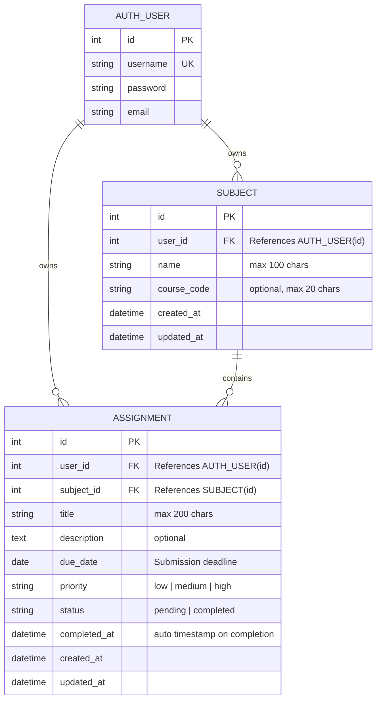

# StudyTrack — Student Assignment & Deadline Manager

> **Academic Mini Project**  
> **Course:** AIM3140 — Web Technologies (Semester V, B.Tech CSE AI/ML)  
> **Tech Stack:** Python, Django (MVT), MySQL (InnoDB), HTML5, CSS3, Bootstrap 5, JavaScript  

---

## 1. Project Overview & Problem Statement

### Problem Statement
College and university students frequently struggle to keep track of concurrent coursework deadlines across multiple subjects. Assignments and lab deliverables are often recorded haphazardly in notebooks, mobile reminders, or group chats, leading to missed deadlines, poor grade tracking, and high academic stress.

### Project Objective
**StudyTrack** is an academic web application designed to help students:
1. Systematically register and organize subjects and course codes.
2. Track assignments with due dates, priority tiers (High, Medium, Low), and statuses (Pending, Completed).
3. Monitor academic progress via an interactive, metric-driven dashboard.
4. Receive automated visual alerts for overdue submissions.
5. Demonstrate fundamental web technologies: HTTP methods, MVC/MVT architecture, relational database persistence (MySQL CRUD), server-side input validation, CSRF protection, and responsive frontend design.

---

## 2. Technology Stack & Architecture

| Layer | Technology | Purpose & Implementation Details |
|---|---|---|
| **Backend & Web Framework** | Python 3 + Django 6.x | Handles routing, views, authentication, template rendering, and ORM. |
| **Architecture Pattern** | Django MVT | **Model** (data/ORM), **View** (business logic/HTTP), **Template** (UI rendering). |
| **Relational Database** | MySQL 8.x | Primary persistent storage for users, subjects, and assignments. |
| **Database Connector** | PyMySQL (`pymysql.install_as_MySQLdb()`) | Pure-Python, cross-platform MySQL connector compatible with Django ORM. |
| **Frontend Framework** | HTML5 + CSS3 + Bootstrap 5.3 | Responsive grid, cards, accessible form inputs, and navigation. |
| **Client-Side Scripting** | Vanilla JavaScript | Progressive enhancement, AJAX completion toggle via `fetch()`, delete confirmations. |
| **Authentication & Security**| Django Auth & CSRF Middleware | PBKDF2 password hashing, session tokens, CSRF tokens on all POST mutations. |

---

## 3. Database Design & Entity Relationship (ER) Diagram

### Entity Relationship Model



### Key Data Integrity & Security Rules
1. **Student Scoping:** All subject and assignment queries are strictly scoped to `request.user`. User A can never view, mutate, or delete User B's records.
2. **Cross-User Subject Protection:** An assignment's owner must match the subject's owner (`assignment.user == assignment.subject.user`). This is enforced at both the **Model** layer (`clean()`) and the **Form** layer (`AssignmentForm.clean_subject()`).
3. **Subject Deletion Integrity:** If a subject has active assignments, deletion is **strictly blocked** with an informative message instructing the student to delete or reassign their coursework first.
4. **Overdue Calculation Boundary:** An assignment is categorized as **overdue** if and only if `status == 'pending'` and `due_date < timezone.localdate()`. Completed tasks never count as overdue.

---

## 4. Prerequisites & Environment Setup

### Prerequisites
* **Python 3.10+** (Tested on Python 3.14)
* **MySQL Server 8.x** or **MariaDB**
* **Git** and terminal shell (PowerShell or Bash)

### Step 1: Clone Repository & Create Virtual Environment
```bash
# Navigate to the project directory
cd studytrack

# Create a virtual environment
python -m venv .venv

# Activate virtual environment:
# On Windows (PowerShell):
.venv\Scripts\Activate.ps1
# On Linux/macOS:
source .venv/bin/activate

# Upgrade pip and install dependencies
pip install -r requirements.txt
```

### Step 2: Configure Environment Variables
Copy the `.env.example` file to create your local `.env`:
```bash
# Windows PowerShell
copy .env.example .env

# Linux / macOS
cp .env.example .env
```

Open `.env` and configure your local MySQL credentials:
```ini
SECRET_KEY=your-secure-random-secret-key
DEBUG=True
ALLOWED_HOSTS=127.0.0.1,localhost

# MySQL Database Details
DB_ENGINE=django.db.backends.mysql
DB_NAME=studytrack_db
DB_USER=studytrack_user
DB_PASSWORD=your_mysql_password
DB_HOST=127.0.0.1
DB_PORT=3306

# Note: Set USE_SQLITE=True only if running isolated tests in an environment without MySQL
USE_SQLITE=False
```

### Step 3: Setup MySQL Database
Log into your MySQL terminal or Workbench and execute:
```sql
CREATE DATABASE IF NOT EXISTS studytrack_db CHARACTER SET utf8mb4 COLLATE utf8mb4_unicode_ci;
CREATE USER IF NOT EXISTS 'studytrack_user'@'localhost' IDENTIFIED BY 'your_mysql_password';
GRANT ALL PRIVILEGES ON studytrack_db.* TO 'studytrack_user'@'localhost';
FLUSH PRIVILEGES;
```

### Step 4: Apply Database Migrations
Execute Django migrations to generate all application tables and relationships in MySQL:
```bash
python manage.py migrate
```

### Step 5: (Optional) Seed Sample Academic Demo Data
Populate realistic demo records (students, subjects, upcoming deadlines, overdue tasks) with a single command:
```bash
python seed_demo_data.py
```
*Creates two demo accounts:*
* Username: `rahul_cse` | Password: `student123`
* Username: `priya_aiml` | Password: `student123`

### Step 6: Create an Admin Superuser (Optional)
```bash
python manage.py createsuperuser
```

### Step 7: Run the Development Server
```bash
python manage.py runserver
```
Visit `http://127.0.0.1:8000/` in your web browser.

---

## 5. Running Automated Tests

StudyTrack includes 15 automated test cases testing authentication, authorization, CRUD operations, cross-user subject isolation, dashboard calculations, and filter safety.

To run the full test suite:
```bash
python manage.py test
```

### Test Suite Output Verification:
```
Creating test database for alias 'default'...
...............
----------------------------------------------------------------------
Ran 15 tests in 10.769s

OK
Destroying test database for alias 'default'...
```

---

## 6. Project Directory Structure

```
studytrack/
├── .env.example              # Template environment variables (no secrets committed)
├── .gitignore                # Git ignore rules for virtual environments & secrets
├── requirements.txt          # Python dependencies (Django, PyMySQL, python-dotenv, cryptography)
├── manage.py                 # Django CLI management entrypoint
├── seed_demo_data.py         # Automated database seeder for demo presentation
├── README.md                 # Project documentation and viva guide
├── config/                   # Django Project Configuration
│   ├── __init__.py           # PyMySQL registration (pymysql.install_as_MySQLdb)
│   ├── settings.py           # Settings with MySQL config & environment loader
│   ├── urls.py               # Main URL configuration
│   ├── wsgi.py               # WSGI entrypoint
│   └── asgi.py               # ASGI entrypoint
├── tracker/                  # Main StudyTrack Application
│   ├── admin.py              # Django admin model registration
│   ├── apps.py               # Application configuration
│   ├── forms.py              # SubjectForm, AssignmentForm, StudentRegistrationForm
│   ├── models.py             # Subject and Assignment models with clean() validation
│   ├── urls.py               # URL routing for dashboard, subjects, and assignments
│   ├── views.py              # View functions implementing business logic & CRUD
│   ├── tests.py              # 15 automated tests for auth, CRUD, ownership, and metrics
│   └── migrations/
│       └── 0001_initial.py   # Database migration generating MySQL schema
├── templates/                # HTML5 & Bootstrap 5 Templates
│   ├── base.html             # Common layout with navbar, alerts, footer
│   ├── landing.html          # Public homepage with project overview & live preview card
│   ├── registration/
│   │   ├── login.html        # Student login form
│   │   └── register.html     # Registration form with validation errors
│   └── tracker/
│       ├── dashboard.html    # Statistics cards, upcoming deadlines, overdue warnings
│       ├── assignment_list.html # Search, multi-field filters, and status badges
│       ├── assignment_form.html # Create and edit assignment form
│       ├── assignment_confirm_delete.html # Assignment deletion confirmation
│       ├── subject_list.html    # Enrolled subjects with task count badges
│       ├── subject_form.html    # Create and edit subject form
│       └── subject_confirm_delete.html # Subject deletion confirmation
└── static/
    ├── css/
    │   └── style.css         # Academic navy color theme, badges, and card styling
    └── js/
        └── app.js            # CSRF helper, AJAX toggle fetch(), auto-dismiss alerts
```

---

## 7. AIM3140 Course Syllabus Mapping

| Syllabus Topic | Practical Implementation in StudyTrack |
|---|---|
| **Internet & HTTP Protocol** | HTTP Request-Response lifecycle, distinction between safe `GET` (search, filtering) and state-mutating `POST` (create, update, delete, status toggle). |
| **HTML5 & Semantic Structure** | Semantic tags (`<nav>`, `<main>`, `<header>`, `<footer>`, `<form>`, `<input type="date">`). |
| **Forms & Input Validation** | Multi-layer validation: HTML5 client-side tags, Django Form validation (`clean_title`, `clean_subject`), and Model constraints (`clean()`). |
| **CSS3 & Responsive Design** | Bootstrap 5 grid system, custom academic color variables (`var(--primary-navy)`), responsive tables, mobile collapse navbar. |
| **JavaScript & DOM Manipulation** | Client-side CSRF token extraction from cookies, dynamic DOM updates on completion toggle without full-page reloads, confirm dialog handlers. |
| **Python Web Programming** | Django views, context dictionaries, query parameters parsing, custom business logic. |
| **MySQL Database CRUD** | Persistent storage in MySQL tables, Foreign Keys (`ON DELETE CASCADE`), indexes (`user_id, status, due_date`). |
| **Django MVT Architecture** | Models (`tracker.models`), Views (`tracker.views`), and Templates (`templates/`). |
| **Django ORM & QuerySets** | `filter()`, `select_related('subject')`, `annotate(Count('assignments'))`, `Q` objects for multi-field search, `aggregate()`. |
| **Security & Authentication** | Django session authentication, PBKDF2 password hashing, CSRF tokens, strict user authorization checks. |

---

## 8. 3-Minute Demonstration Script for Viva

1. **Introduction (30s):**
   * Introduce StudyTrack as a responsive Student Assignment & Deadline Manager designed for AIM3140 Web Technologies.
   * State the tech stack: Django MVT + MySQL persistence + HTML5/CSS3/Bootstrap 5 + JavaScript.
2. **First-Time Student Walkthrough (45s):**
   * Register a new student account (`rahul_cse`).
   * Show the empty state on the Dashboard: *"Welcome! Add your first subject to get started."*
   * Create a subject: *"Web Technologies (AIM3140)"*.
   * Add an assignment: *"StudyTrack Mini Project"*, High priority, due in 2 days.
3. **Dashboard & Metric Verification (45s):**
   * Show how metrics automatically compute from MySQL: Total Assignments (4), Pending (3), Completed (1), Overdue (1), Completion Rate (25%).
   * Point out the **Red Overdue Alert Banner** highlighting tasks past their submission date.
4. **Search, Filtering, and AJAX Completion (30s):**
   * Navigate to Assignments. Demonstrate combined search (`"Banker"`) and filter by Subject / Priority.
   * Click **"Mark Done"** to demonstrate instantaneous status update via AJAX `fetch()` while retaining CSRF protection.
   * Show that completed assignments **never count as overdue**, even if their due date is in the past.
5. **Security & Data Integrity (30s):**
   * Log out and log in as second student (`priya_aiml`).
   * Show that Priya only sees her own Database Systems subject and assignments.
   * Attempt to modify an assignment URL with Rahul's assignment ID; show the secure **404 Not Found** response.
   * Demonstrate deleting a subject that contains assignments; show the blocked deletion integrity alert.

---

## 9. Viva Questions & Answers

**Q1: What is the difference between Django's MVT architecture and traditional MVC?**  
> *A:* In MVC, the **Controller** processes requests and controls data flow. In Django's MVT:
> * **Model (M):** Handles database schema and ORM mappings.
> * **View (V):** Acts like the Controller; it contains the business logic, queries models, and selects templates.
> * **Template (T):** The presentation layer that renders HTML dynamically with Django Template Language.

**Q2: How does StudyTrack connect to MySQL instead of SQLite?**  
> *A:* In `config/settings.py`, `DATABASES['default']['ENGINE']` is configured to `'django.db.backends.mysql'`. In `config/__init__.py`, `pymysql.install_as_MySQLdb()` wraps PyMySQL so Django communicates directly with the MySQL server using standard SQL queries and transactions.

**Q3: How is cross-user data leakage prevented?**  
> *A:* Every private query filters explicitly by `user=request.user`. Furthermore, when creating or updating an assignment, `AssignmentForm` and `Assignment.clean()` verify that `subject.user == request.user`, preventing an attacker from tampering with POST parameters to link tasks to another student's subject.

**Q4: Why must state-changing actions use POST instead of GET?**  
> *A:* According to HTTP specifications, `GET` requests must be idempotent and safe (no side effects on the server). Using `GET` for deletions or status changes would allow malicious websites, web crawlers, or browser pre-fetching to accidentally trigger destructive actions. Using `POST` ensures requests require a valid `csrfmiddlewaretoken`.

---

## 10. Known Limitations & Future Enhancements

* **Current Limitations:**
  * Requires a running local or remote MySQL server instance.
  * DateField stores submission calendar dates without specific submission hours/minutes.
* **Future Roadmap:**
  * Real-time deadline notifications via browser Web Push API.
  * Calendar monthly grid view using FullCalendar.js.
  * Integration with college LMS platforms (Moodle/Canvas).
